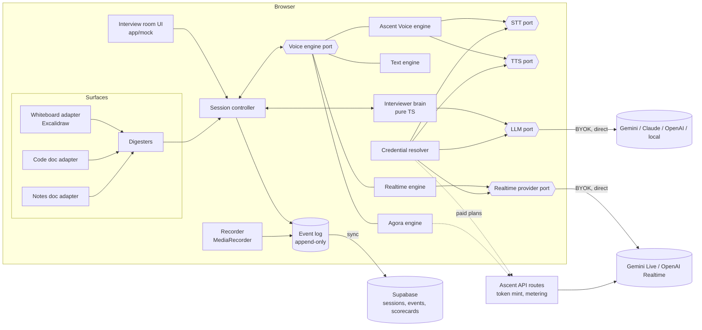
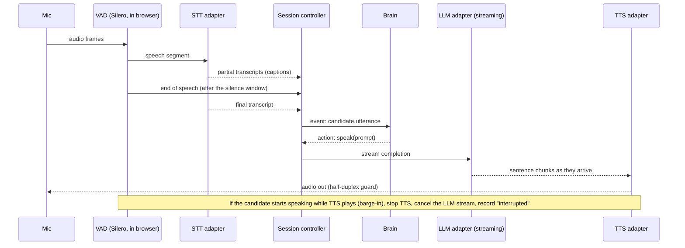

# Voice mock interviewer: architecture

## 1. Context

Ascent is a Next.js 16 App Router app whose pages render in the browser. Supabase provides auth and per-user storage, protected by row-level security. Guest mode keeps everything in `localStorage`. AI calls go straight from the browser to the learner's chosen provider, with keys stored in the browser (`lib/ai.ts`). There are no server routes today.

This design keeps that shape for the BYOK path. **Phases 1–3 need no Ascent server code to run a voice round.** Server routes appear only for paid plans (Phase 4), the optional Agora engine, and a few stateless helpers.

## 2. The engine decision in one table

The question that shaped this architecture: *can we skip Agora, so learners don't need two accounts, without losing quality?* Yes. For a one-to-one conversation with an AI, Agora's main value is a managed media network (WebRTC transport between many participants) together with a tuned STT → LLM → TTS pipeline. A single learner talking to a model needs neither a media network nor a second vendor. The learner's existing AI provider already sells low-latency speech-to-speech, and the parts that make the interviewer *good* (state, phases, whiteboard digests, the decision to interrupt) are code we would write either way.

| | Text | Ascent Voice (cascaded, in browser) | Realtime voice (provider) | Agora (optional) |
| --- | --- | --- | --- | --- |
| Accounts needed | AI key | AI key (any provider, including Claude or local) | Gemini or OpenAI key | Agora project plus, usually, an AI key |
| How it works | Typed chat | Browser voice activity detection (VAD) → STT → our LLM call → TTS | Browser streams audio to the provider's realtime model, which speaks back | Agora cloud agent joins a WebRTC channel and runs STT → LLM → TTS |
| Turn-taking and barge-in | n/a | Ours (VAD + endpointing), tunable | Provider's server or semantic VAD, strong | Agora's VAD, strong |
| Typical latency | n/a | ~1.2–2.5 s, depending on STT and TTS choice | sub-second when conditions are good | sub-second when conditions are good |
| Voice naturalness | n/a | Browser voices are robotic; provider TTS is good | Best: native audio models | Good (vendor TTS) |
| Control per turn | Full | Full: every turn passes through the brain | High: instructions plus injected context; the model owns turn timing | Full only if Agora's LLM calls an Ascent endpoint (needs a server and keys server-side) |
| Whiteboard into context | Digest | Digest, plus an image on request | Digest, plus images or video frames natively | Digest over RTM, plus images |
| Session length | Unlimited | Unlimited | Provider limits: needs resumption or compression (§4.3) | Configurable expiry |
| Cost to learner | LLM tokens | LLM tokens, plus STT and TTS if a paid vendor is chosen | Realtime audio tokens (highest per minute) | Agora minutes plus LLM |
| Server needed | No | No | No for BYOK; yes for paid plans (to mint ephemeral tokens) | Yes (tokens, agent start and stop) |

**Recommendation:** make *Realtime voice* the default voice engine when the learner has a Gemini or OpenAI key. *Ascent Voice* is the universal fallback, covering Claude, local models and the free tier. Agora stays an optional adapter, worth adding if a learner prefers it or if Phase 3 peer mode needs a managed media network (it probably won't: see §4.5). Recorded in [ADR 0003](../../adr/0003-provider-realtime-voice-as-default.md).

What we still do **not** build ourselves: speech recognition models, speech synthesis models, and WebRTC media servers. Building those would cost quality.

## 3. Component view

### 3.1 Responsibilities

| Component | Responsibility | Owns state? |
| --- | --- | --- |
| Interview room UI | Layout, controls, captions, timer, debug overlay | View state only |
| Session controller | Runs the session state machine. Wires the engine, surfaces, brain and recorder together. Writes every event to the log. | Session lifecycle |
| Interviewer brain | Pure functions. Given the config, state and a new event, it returns the next state plus *actions*: say something, stay silent, change phase, start a curveball, request a vision look. It also builds every prompt. | Interview state (as data, not side effects) |
| Intervention policy (part of the brain) | Deterministic gates (silence, phase budget, digest rule hits, rate limits by tone and pressure), then a model judgement for anything borderline | — |
| Voice engine port | Moves audio and text between the learner and a model. Reports speech start and end, partial and final transcripts, and agent speaking state. | Connection only |
| Surface adapters | Wrap a workspace widget and emit snapshots | Widget state |
| Digesters | Turn snapshots into compact text digests and diffs, and tag components semantically | Last snapshot |
| LLM / STT / TTS / Realtime ports | Provider adapters behind narrow interfaces, with capability flags | — |
| Credential resolver | Answers "which credential pays for this task?": BYOK from the browser, or a platform token from the API | — |
| Event log | Append-only, timestamped record of everything. The single source for scorecards, replay and analytics. | Durable |
| Recorder | Optional local recording of mic plus interviewer audio. Upload is opt-in. | Blob |
| Recommender | Deterministic function from progress data to suggested mock configurations (no AI) | — |

### 3.2 Why the brain is a pure module

The same brain has to drive four engines. In the browser, Text, Ascent Voice and Realtime call it directly. On the server, an Agora "custom LLM" endpoint would call it. Keeping it free of I/O means:

1. it runs in either place without change;
2. it can be unit-tested by replaying an event log and asserting the actions it returns;
3. it can be evaluated offline (see [AI configuration §6](04-ai-configuration.md#6-evaluation-and-calibration)).

## 4. Engines

### 4.1 Text engine

Today's behaviour, moved onto the new core. Each candidate message goes to the brain, the brain builds the prompt, the LLM port returns the reply, and the reply goes to the transcript.

### 4.2 Ascent Voice engine (cascaded, in the browser)

- **VAD**: Silero VAD via ONNX Runtime Web in a worker. The end-of-speech window is tunable (default 700 ms; *Relaxed* pressure 1000 ms), so thinking pauses are not cut off.
- **STT adapters**: `webspeech` (Chrome or Edge; free; audio is processed by the browser vendor unless on-device recognition is available), `whisper-local` (Whisper via WebGPU; private; slower on weak machines), and provider STT using the learner's key where one exists.
- **TTS adapters**: `speechSynthesis` (free, local voices), provider TTS (Gemini or OpenAI with the same key).
- **Latency tactics**:
  - stream LLM tokens and start TTS at the first sentence boundary;
  - keep the system prompt stable so provider prompt caching applies;
  - send speculative "pre-warm" requests on partial transcripts only when the developer setting is on.
- **Echo**: use `echoCancellation` in `getUserMedia`, and gate VAD while TTS plays unless barge-in is enabled.

### 4.3 Realtime voice engine

The browser opens a realtime session directly with the provider: a WebSocket for Gemini Live, WebRTC for OpenAI Realtime. The session is configured with:

- the brain's system instructions;
- the selected voice;
- turn detection (server or semantic VAD);
- transcription of both sides, for captions and the event log.

Brain integration on a speech-to-speech model works through three levers:

1. **Instructions** are set at session start, and updated when the phase changes where the provider supports mid-session instruction updates.
2. **Context injection**: digests, time calls and curveball cues are sent as text conversation items. Images go as image items or video frames where the provider supports them.
3. **Proactive speech**: to intervene, the controller injects the cue and explicitly asks for a response. To *suppress* a reply, the session disables automatic responses after injected context, so only the candidate's speech triggers an automatic reply.

Known constraints (to be verified during the Phase 2 spike, see [delivery plan §5](05-delivery-plan.md#5-open-questions-and-verification-list)):

- **Session length.**
  - *OpenAI*: Realtime sessions are documented at up to 60 minutes. A 45-minute round fits. A loop day uses one session per round.
  - *Gemini*: Live sessions are limited (reported as about 15 minutes for audio-only), with connections of about 10 minutes. The adapter enables context-window compression, handles `GoAway`, and reconnects with a session-resumption handle. The brain re-seeds a state summary if resumption fails.
- **Browser credentials.** With BYOK, the learner's own key is used from their own browser, as today. On paid plans the browser never sees an Ascent key: `/api/realtime/token` mints a short-lived ephemeral token.
- **Model choice is fixed for the session.** Changing the model means reconnecting, so developer mode applies model changes at the next round.

### 4.4 Agora engine (optional)

This engine is kept as an adapter because the architecture makes it cheap, and some learners may prefer Agora's pipeline or already have credits. There are two sub-modes:

- *Agora-managed LLM*: Agora runs its own reseller LLM. The brain's instructions go in at start, and digests and cues go in as RTM text messages. This needs only an Agora project, which is the zero-AI-key path shown in the video.
- *Ascent brain*: Agora's custom-LLM URL points at an Ascent route that runs the brain on the server. This needs the learner's LLM key on the server for the length of the session, which conflicts with our "keys stay in the browser" principle. It is deferred and would need a sealed, session-scoped token design (sketched in [ADR 0004](../../adr/0004-byok-first-platform-credentials-later.md)).

Server routes needed by both sub-modes: `POST /api/agora/token`, `POST /api/agora/start` and `POST /api/agora/stop`. They are stateless and receive the learner's Agora credentials per request without persisting them. Orphaned agents are prevented by the agent's own idle timeout and expiry, plus a stop on `pagehide`.

**As built** ([ADR 0006](../../adr/0006-agora-engine-agora-managed-stateless-route.md)): only the Agora-managed sub-mode, through one route `POST /api/agora/[action]` (`start`, `stop`, `think`, `speak`, `update`) using Agora's `agora-agents` SDK with the learner's App ID and App Certificate. The browser uses `agora-rtc-sdk-ng`, loaded on demand; transcripts arrive as RTC stream messages.

### 4.5 Peer mode transport

Two browsers connect directly over WebRTC. Signalling runs over Supabase Realtime channels, which Ascent already depends on. Public STUN servers handle most networks. A TURN relay covers the rest, and is the only new paid dependency (decided in Phase 3). The AI observer listens to both sides through the Ascent Voice engine's STT, in one browser, with consent shown to both peers.

**As built** ([ADR 0005](../../adr/0005-peer-transport-direct-webrtc-byo-turn.md)): Ascent hosts no TURN relay; learners may add their own. Each browser transcribes its own microphone and shares finished lines over the data channel, the candidate's workspace is mirrored to the interviewer, and the AI observer scores in the candidate's browser with the candidate's key.

## 5. Data flow and storage

| Data | Where it lives | Notes |
| --- | --- | --- |
| Session config and status | `interview_sessions` (Supabase), or local in guest mode | One row per round |
| Events (turns, digests, interventions, phases, hints, curveballs) | `interview_events`, append-only | Batched writes every few seconds and on end. Local IndexedDB first, so a crash or offline period loses nothing. |
| Scorecard | `interview_scorecards`, plus an `attempts` row (kind `mock:<kind>`) for backward compatibility | Evidence references event sequence numbers |
| Recordings and whiteboard snapshots | Supabase Storage bucket `interview-media` (private, per-user path) | Opt-in. Retention setting, 30 days by default. |
| Weakness profile | Derived on read from scorecards and SRS data. Cached in `profiles.settings`. | No new table |
| Usage ledger | `usage_ledger` | Phase 4. Platform-paid usage only. BYOK usage is estimated locally and never sent. |

Full schema: [detailed design §6](03-detailed-design.md#6-database-schema).

## 6. Scalability

The BYOK path scales with the number of learners at almost no cost to Ascent, because each browser does its own media and model work. Server-side growth only comes from sync writes and, later, paid plans.

| Concern | Approach |
| --- | --- |
| Event write volume | Client batching (one insert per 5 s or 50 events). Events are small (digests are diffs). Index on `(session_id, seq)`. Partition `interview_events` by month when it passes ~50 M rows. Old sessions keep their events but drop raw digests after 90 days. |
| Read paths | Scorecards and the session list read from `interview_sessions` and `interview_scorecards`. Replay streams events by session, in pages. |
| API routes (paid plans and Agora) | Stateless Node.js functions on Vercel Fluid Compute, with idempotency keys on start and stop. Per-user rate limits run in front of the routes. Token minting is O(1) and needs no shared state. |
| Metering correctness | The usage ledger is append-only, idempotent per `(session_id, resource, window)`. A reconciliation job compares it with provider usage exports. |
| Cost leaks | Ephemeral tokens with short TTLs. Session expiry is enforced at the provider. A scheduled reaper closes `interview_sessions` stuck in `live` past their deadline and stops any Agora agent still running. |
| Provider outages | The engine fallback chain (realtime → Ascent Voice → text) runs mid-session without losing state, because the brain and the event log are engine-independent. |
| Content growth | Question sources are adapters (curriculum, imported, AI-generated), so pool queries do not depend on where questions come from. |

## 7. Extensibility: the adapter registry

Every pluggable capability is a port (a TypeScript interface) with a registry. Adding a capability means writing one adapter and registering it. Interfaces are in [detailed design §2](03-detailed-design.md#2-ports-and-adapters).

| Port | Shipped adapters | Likely next |
| --- | --- | --- |
| `VoiceEngine` | text, ascent-voice, realtime, agora | provider-hosted voice agents, telephony |
| `LlmProvider` | gemini, claude, openai-compatible (local, OpenAI, others) | any OpenAI-compatible gateway |
| `RealtimeProvider` | gemini-live, openai-realtime | others speaking the OpenAI Realtime protocol |
| `SttProvider` | webspeech, whisper-local, provider STT | Deepgram (BYOK) |
| `TtsProvider` | speech-synthesis, provider TTS | ElevenLabs (BYOK) |
| `Surface` and `Digester` | code-doc, whiteboard-hld, whiteboard-lld, notes | SQL scratchpad, API-spec editor |
| `QuestionSource` | curriculum, imported, ai-generated | company-specific packs |
| `Curveball` | 8 strategies (spec §5) | community-contributed |
| `Persona` and `Tone` | 5 tones, seeded personas | per-company styles |
| `Scorer` | google-rubric | other companies' rubrics |
| `CredentialSource` | byok-browser, platform | org-provided keys |

Rules that keep the core stable:

- Adapters declare **capabilities** (`supportsTopK`, `supportsImages`, `maxSessionMinutes`, …). The core asks about capabilities and never branches on adapter names.
- The core only talks to ports. Adapters do not import each other.
- Each adapter has a contract test suite (in `lib/interview/__tests__/contracts`) that every implementation must pass.
- Registries are plain maps keyed by ID and loaded lazily, so unused adapters (Agora's SDK, Whisper weights) are not downloaded.

## 8. Security and privacy

| Topic | Decision |
| --- | --- |
| BYOK keys | Stay in `localStorage` as today, and are sent only to their own provider. Never sent to Ascent, never logged, never synced. |
| Paid-plan keys | Server-only environment variables. Browsers receive short-lived, session-scoped ephemeral tokens. |
| Agora credentials (optional engine) | Sent per request to stateless routes, held in memory for that request, and redacted from logs. |
| Privacy mode | On-device Whisper (Transformers.js in a worker, loaded on demand) or Chrome on-device recognition, local voices only, the local model server for every task, and no cloud sync for the round ([ADR 0007](../../adr/0007-on-device-speech-for-privacy-mode.md)). Every round shows a computed "What leaves this device" list. |
| Audio | Not stored unless the learner opts in. The *Privacy mode* label lists exactly which services receive audio for the chosen engine. With Chrome's Web Speech, audio goes to Google unless on-device recognition is used. That corrects an earlier assumption that browser STT is always local. |
| Prompt injection | Candidate speech, code and whiteboard text are wrapped as quoted data in prompts and never placed in the instruction section. In peer mode, the other peer is untrusted input. |
| Data isolation | Row-level security on every new table (`user_id = auth.uid()`). Storage policies match per-user paths. |
| Consent | Mic permission explained before the first round. Recording and peer-mode observation need explicit consent. |
| Abuse (paid plans) | Per-user quotas, rate limits, bot checks on sign-up, and one active realtime session per user. |

## 9. Observability

- **Client**: each session's event log already holds latency marks (speech end → first audio, LLM time to first token, TTS start). The debug overlay reads them, and aggregated (anonymous) numbers can be sent with consent.
- **Server** (paid plans): structured logs without secrets, a request ID per session, metrics for tokens minted, active sessions and quota rejections.
- **Quality**: scorecard evaluations run against a labelled set on each prompt or model change ([AI configuration §6](04-ai-configuration.md#6-evaluation-and-calibration)).

## 10. Implementation notes

- This repo's Next.js version has breaking changes from older releases. Read `node_modules/next/dist/docs/` before adding route handlers (`app/api/**/route.ts`).
- API routes use the default Node.js runtime. Streaming works there; do not use the Edge runtime.
- New client-heavy libraries (Excalidraw, ONNX Runtime, Whisper) load only on the mock page, using dynamic imports.
