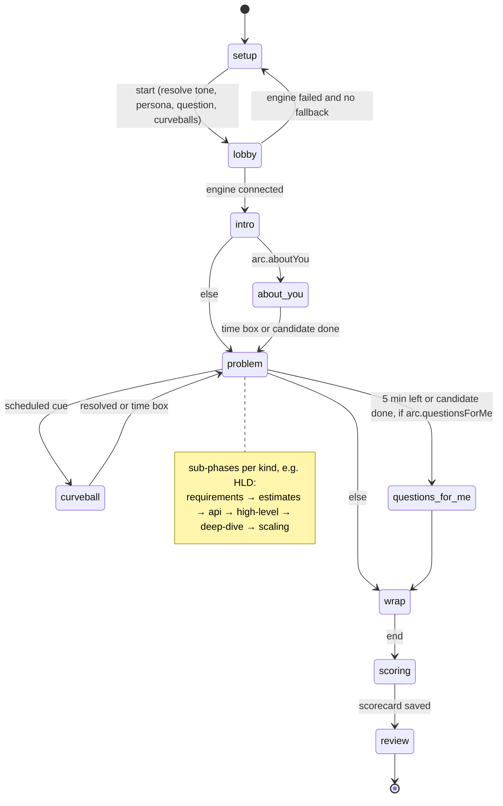

# Voice mock interviewer: detailed design

Code layout (as built; the planned split into more files can happen as each area grows):

```
lib/interview/
  core/        pure, no I/O, runs under node --test
    types.ts       config, events, state, actions
    brain.ts       the reducer
    policy.ts      pressure table, gates, stage budgets
    prompts.ts     system prompt, context note, realtime note, judge prompt
    curveballs.ts  strategies and scheduler
    digest.ts      whiteboard and text digests, semantic tags, red-flag rules
    persona.ts     seeded fictional interviewer, tone draw
    scoring.ts     rubric dimensions, scorecard prompt, parse, median aggregation
    analytics.ts   delivery stats
    recommender.ts suggested mocks, mock-day spacing
    core.test.ts
  providers/   llm.ts (Gemini, Claude, OpenAI, local; capabilities; streaming; vision), keys.ts (BYOK source)
  engines/     types.ts (ports), text.ts, ascent-voice.ts (STT and TTS adapters inside), realtime-gemini.ts,
               realtime-openai.ts, audio.ts (VAD, PCM capture and playback), registry.ts
  tasks.ts     task catalogue, presets, AI settings, runTask and streamTask
  questions.ts question sources, pools, AI-generated questions, key terms
  session.ts   session controller
  results.ts   scoring runner, local history, mapping to Ascent's Feedback
components/interview/  Setup, Room, WhiteboardCanvas (Excalidraw), Scorecard, AiSettingsPanel
app/mock/page.tsx      setup → room → predict → debrief
```

`lib/ai.ts` keeps its public functions (`chat`, `reviewCode`, …) as thin wrappers over `providers/llm/*`, so existing pages keep working unchanged.

## 1. Session configuration

```ts
type Kind = "coding" | "hld" | "lld" | "behavioral";
type Tone = "guide" | "neutral" | "tough" | "notetaker";

interface SessionConfig {
  kind: Kind;
  selection:
    | { mode: "random-all"; preferUnseen: boolean }
    | { mode: "random-pool"; pool: PoolFilter }
    | { mode: "exact"; questionId: string };          // flagged "practice pick" in analytics
  tone: Tone | "surprise";                             // resolved at start; hidden until scorecard if "surprise"
  level: "L3" | "L4" | "L5" | "L6";
  minutes: number;                                     // 15–60
  arc: { intro: boolean; aboutYou: boolean; curveball: boolean; questionsForMe: boolean };
  pressure: "relaxed" | "realistic" | "high";
  curveballs: { frequency: "none" | "occasional" | "frequent" | "random"; disabled: CurveballId[] };
  engine: EngineId;                                    // "text" | "ascent-voice" | "realtime" | "agora"
  voice?: { voiceId?: string; rate: number; captions: boolean };
  mode: "real" | "coach";
  surfaces: SurfaceId[];                               // derived from kind; overridable
  aiProfile: string;                                   // developer-mode profile ID (04 §3)
  seed: number;                                        // persona, tone draw and curveball schedule are reproducible
}

interface PoolFilter {
  topics?: string[]; tiers?: (1 | 2 | 3)[];
  sources?: ("curriculum" | "imported" | "ai-generated")[];
  status?: ("unseen" | "due" | "weak" | "done")[];
}
```

## 2. Ports and adapters

```ts
interface Capabilities { [flag: string]: boolean | number | string }

interface LlmProvider {
  id: string;
  capabilities: Capabilities;   // topK, seed, jsonSchema, images, promptCaching, reasoningEffort, maxContext
  complete(req: LlmRequest, signal?: AbortSignal): Promise<LlmResult>;
  stream(req: LlmRequest, signal?: AbortSignal): AsyncIterable<LlmDelta>;
  listModels(cred: Credential): Promise<ModelInfo[]>;
}
interface LlmRequest {
  model: string; system: string; messages: Msg[]; params: GenParams;   // 04 §3
  responseSchema?: JsonSchema; cacheKey?: string;
}

interface RealtimeProvider {
  id: string;
  capabilities: Capabilities;   // maxSessionMinutes, resumable, images, videoFrames, semanticVad, midSessionInstructions
  connect(opts: RealtimeOptions, cred: Credential): Promise<RealtimeSession>;
}
interface RealtimeSession {
  updateInstructions(text: string): Promise<void>;
  inject(item: { text?: string; imagePng?: Blob }, opts: { respond: boolean }): Promise<void>;
  interrupt(): void;
  on(e: "userSpeechStart" | "userSpeechEnd" | "userTranscript" | "agentTranscript" | "agentSpeaking" | "goAway" | "error", fn: (p: unknown) => void): void;
  close(): Promise<void>;
}

interface SttProvider { id: string; capabilities: Capabilities; start(stream: MediaStream, opts: SttOptions): SttSession }
interface TtsProvider { id: string; capabilities: Capabilities; speak(text: AsyncIterable<string>, opts: TtsOptions): TtsPlayback }

interface VoiceEngine {
  id: EngineId;
  requirements(settings: Settings): Requirement[];     // shown on the setup screen
  estimateCost(cfg: SessionConfig): CostEstimate;
  start(ctx: EngineContext): Promise<EngineHandle>;    // ctx exposes brain dispatch and the event log
}
interface EngineHandle {
  say(text: string, opts: { interruptible: boolean }): Promise<void>;   // text engine: append to chat
  injectContext(item: ContextItem): Promise<void>;
  setInstructions(text: string): Promise<void>;
  mute(on: boolean): void;
  stop(): Promise<void>;
}

interface Surface<S> { id: SurfaceId; mount(el: HTMLElement): void; snapshot(): S; onPause(ms: number, fn: (s: S) => void): () => void }
interface Digester<S> { digest(prev: S | null, next: S): Digest | null }   // null = change not meaningful
interface Digest { surface: SurfaceId; full: string; diff: string; tags: ComponentTag[]; bytes: number }

interface QuestionSource { id: string; list(filter: PoolFilter, kind: Kind): Promise<QuestionRef[]>; load(ref: QuestionRef): Promise<InterviewQuestion> }

interface CredentialSource { id: "byok" | "platform"; resolve(task: TaskId, provider: string): Promise<Credential | null> }
```

`InterviewQuestion` extends today's `Q` (`app/mock/page.tsx`) with `constraints` (the numbers to hold the design to), `rubricHints`, `followUps` and `redFlags` (§4.2). Curriculum questions map from the existing `Problem` and `Design` types. AI-generated questions are validated against a schema and saved with `source: "ai-generated"`, so the learner can find them again.

## 3. Session state machine



- Every state transition is an event, so replay and scoring can see exactly when each phase started.
- Each phase has a **time budget**, a share of `minutes` per kind. For a 45-minute HLD round: intro 3, requirements 6, estimates 4, API 4, high-level 10, deep dive 10, scaling 5, questions 3. The policy uses the budgets for time calls and for moving the candidate on.
- **Engine fallback** is a self-transition that swaps `EngineHandle`. The brain state and log are unchanged, and the interviewer says one line ("Sorry, we lost the line, let's continue here").
- The thinking pause (MI-REAL-5) is a flag on the state, not a phase. The clock keeps running.

## 4. Interviewer brain

### 4.1 Reducer

```ts
type Action =
  | { type: "say"; prompt: PromptSpec; interruptible: boolean }     // engine generates and speaks it
  | { type: "inject"; item: ContextItem; respond: boolean }          // realtime and Agora engines
  | { type: "setInstructions"; text: string }
  | { type: "phase"; to: Phase }
  | { type: "visionLook"; surface: SurfaceId }
  | { type: "none" };

function reduce(cfg: SessionConfig, s: BrainState, e: SessionEvent, now: number): { state: BrainState; actions: Action[] };
```

The brain never calls a model directly. A `say` action carries a `PromptSpec` (§4.3), and the engine turns it into model output: a text completion, or a realtime "respond" after injecting context.

### 4.2 Intervention policy

The policy decides, for each event, whether the interviewer should speak unprompted:

1. **Hard gates (deterministic).**
   - Never while the candidate is speaking (unless the tone is *Tough*, a red flag is open, and the candidate has spoken for more than 20 s).
   - Never during a thinking pause.
   - Never within the minimum gap since the last intervention.
   - Never above the per-phase cap.

   | Pressure | Min gap | Cap per phase | Silence before nudge |
   | --- | --- | --- | --- |
   | Relaxed | 90 s | 1 | 75 s |
   | Realistic | 45 s | 2 | 45 s |
   | High | 25 s | 3 | 25 s |

2. **Triggers (deterministic).**
   - Silence over the threshold.
   - Phase over budget by 25% or more.
   - A digest rule hit.
   - A scheduled curveball cue.
   - A factual-error marker, e.g. the candidate states a complexity that disagrees with `InterviewQuestion.approaches` for the current approach (coding only, best effort).
3. **Judgement (model).** For digest rule hits and anything else that needs judgement, the brain emits `say` with a prompt that allows an empty answer: "Respond with nothing unless this locks in a real problem." An empty reply is logged as `intervention.declined`.

**Digest rule hits** are pattern checks over tagged components. This is our own deterministic layer; the reference project relies on the prompt alone. Examples:

| Rule | Condition |
| --- | --- |
| `read-path-no-cache` | Read-heavy constraints, a client → … → database path, no `cache`-tagged node on it, and the candidate has moved on from that area |
| `single-db-at-scale` | Exactly one `database` node, data volume above the single-node threshold in `constraints`, and the candidate has reached the scaling phase |
| `sync-fanout` | One service → three or more services with no `queue` node, and a fan-out requirement |
| `blob-in-db` | Media requirement, no `object-store` node, and a database labelled with media |
| `lb-missing` | Two or more app servers with no `load-balancer` |
| `contradiction` | A design element contradicts a requirement the candidate confirmed (tracked as `requirement.confirmed` events) |

Rules return a **suspicion**, not a verdict. The model still decides whether to speak, and the tone adjusts the wording.

### 4.3 Prompt assembly

`PromptSpec` = stable system block + session block + rolling context + instruction for this turn.

| Block | Contents | Changes |
| --- | --- | --- |
| Stable system | Role, voice style (short spoken turns, one question at a time, no lists), honesty rules, how to read the digest format | Never during a session (cache-friendly) |
| Session | Persona, tone, level bar, question and constraints, follow-up bank, red flags, arc, coach notes (coach mode only) | Once at start |
| Rolling context | Latest full digest per surface, the last N turns verbatim, a running summary of older turns, current phase and time left | Every turn |
| Turn instruction | What this action needs, e.g. "deliver the curveball", "time call", "decide whether to challenge" | Per action |

The summary is refreshed by a cheap `summarise` task (see [AI configuration](04-ai-configuration.md)) when history passes the configured token budget. Voice-specific rules ("never output lists or markdown", "1–3 sentences") apply only on voice engines.

## 5. Curveball strategies

```ts
interface Curveball {
  id: CurveballId;
  kinds: Kind[];
  eligible(s: BrainState, q: InterviewQuestion): boolean;   // e.g. requirement-change needs a high-level design on the board
  cue(s: BrainState, q: InterviewQuestion, rng: Rng): PromptSpec;
  scoreNote: string;                                       // tells the scorer what this probed
}
```

At start, the scheduler picks curveballs from the config's frequency and the seed, and places each one in a phase window (e.g. requirement change in the deep dive, a slip in the middle of coding). A curveball fires only if `eligible` is true within its window. Otherwise it is dropped and logged as `curveball.skipped`. Out-of-curriculum questions (MI-CB-4) are resolved before the round starts, in `questions/ai-generated.ts`, so they replace the drawn question rather than interrupt it.

## 6. Database schema

New migration `supabase/migrations/<ts>_interviews.sql`:

```sql
create table public.interview_sessions (
  id uuid primary key,
  user_id uuid not null references auth.users (id) on delete cascade,
  config jsonb not null,                 -- SessionConfig, with tone and persona resolved
  question_ref text not null,            -- curriculum id or ai-generated id
  question_snapshot jsonb not null,      -- the exact question used (content may change later)
  picked boolean not null default false, -- MI-SET-3
  engine text not null,
  status text not null check (status in ('live','scoring','done','abandoned')),
  started_at timestamptz not null default now(),
  ended_at timestamptz,
  deadline_at timestamptz not null,      -- used by the reaper
  loop_id uuid,                          -- MI-X-3
  stats jsonb                            -- delivery analytics (MI-FB-3)
);
create index interview_sessions_user_started_idx on public.interview_sessions (user_id, started_at desc);
create index interview_sessions_live_deadline_idx on public.interview_sessions (deadline_at) where status = 'live';

create table public.interview_events (
  session_id uuid not null references public.interview_sessions (id) on delete cascade,
  seq int not null,
  user_id uuid not null references auth.users (id) on delete cascade,  -- denormalised for RLS
  t_ms int not null,                     -- ms since session start
  type text not null,                    -- see §7
  payload jsonb not null,
  primary key (session_id, seq)
);

create table public.interview_scorecards (
  session_id uuid primary key references public.interview_sessions (id) on delete cascade,
  user_id uuid not null references auth.users (id) on delete cascade,
  decision text not null,                -- strong_no_hire … strong_hire
  level_supported text,
  ratings jsonb not null,                -- [{dimension, score 1-4, evidence: [{seq, quote}]}]
  predicted_decision text,               -- MI-FB-5
  model jsonb not null,                  -- task profile used (provider, model, params, prompt version)
  created_at timestamptz not null default now()
);

-- Phase 4 only
create table public.usage_ledger (
  id bigint generated always as identity primary key,
  user_id uuid not null references auth.users (id) on delete cascade,
  session_id uuid references public.interview_sessions (id) on delete set null,
  resource text not null,                -- realtime_seconds, llm_input_tokens, …
  quantity numeric not null,
  idempotency_key text not null unique,
  created_at timestamptz not null default now()
);
```

Each table gets row-level security in the same style as `20261116000000_init.sql`: an `own …` policy on `(select auth.uid()) = user_id`, all access revoked from `anon`. `usage_ledger` is insert-only from server routes (service role). Users can only `select` their own rows. Storage bucket `interview-media` uses the path `<user_id>/<session_id>/…`, with a matching policy.

Guest mode mirrors the same shapes in IndexedDB (`ascent-interviews`). On sign-in, local sessions are uploaded the same way progress is today.

## 7. Event types

| Type | Payload |
| --- | --- |
| `session.started` / `session.ended` | config hash, engine, reason |
| `phase.changed` | from, to |
| `turn.candidate` | text, start and end ms, `interruptedAgent` |
| `turn.interviewer` | text, start and end ms, `interruptedByCandidate`, action origin (`reply` / `intervention` / `curveball` / `timecall`) |
| `digest` | surface, diff, full (every 5th digest, or on request), tags |
| `rule.hit` | rule id, evidence node ids |
| `intervention.declined` | trigger, reason |
| `curveball.fired` / `curveball.skipped` | id, phase |
| `hint.given` | text, trigger (`asked` / `stall`) |
| `thinking.pause` | start or end |
| `requirement.confirmed` | text (extracted by the `extract` task, or from the notes doc's "Requirements" section) |
| `engine.fallback` | from, to, error |
| `latency` | speech end → first audio, time to first token, TTS start |
| `vision.look` | surface, description |

The scorecard cites events by `seq`. Replay is a pure function of the event log plus optional media.

## 8. API routes (only where a server is needed)

| Route | Phase | Purpose | Contract |
| --- | --- | --- | --- |
| `POST /api/realtime/token` | 4 | Mint a provider ephemeral token on platform credentials | In: `{sessionId, provider, model, voice}`. Out: `{token, expiresAt}`. Checks entitlement, writes a ledger reservation, and accepts one live session per user. |
| `POST /api/usage` | 4 | Commit metered usage at the end of a session | Idempotent on `idempotency_key` |
| `POST /api/agora/token` · `start` · `stop` | 3 | Optional Agora engine | Per-request learner credentials, never persisted. `start` returns `agentId`. `stop` is idempotent. |
| Scheduled `reap` | 3 | Close stale `live` sessions past `deadline_at` and stop leftover agents | Vercel cron |

## 9. Recommender

`lib/interview/recommender.ts` is deterministic and takes no AI calls. It runs when the roadmap is built:

```
score(kind, pool) =
    w1 · coverage(kind)          # finished topics in the kind with no mock yet
  + w2 · weakness(kind)          # low rubric dimensions in the last 3 scorecards of that kind
  + w3 · lapses(pool)            # SRS lapses in the pool's topics
  + w4 · miscalibration(kind)    # predicted − actual decision gap
  + w5 · staleness(kind)         # days since the last mock of that kind
  − w6 · recentRepeat(pool)      # avoid the same pool twice in a row
```

The top candidates fill mock slots spaced by `schedule.ts`. Density goes from one mock every ~7 study days at the start to one every ~2 in the final 20% of the plan. Each slot stores its `SessionConfig` and a `reason` string, which the roadmap shows. Weights live in one constants block, so they can be tuned.
